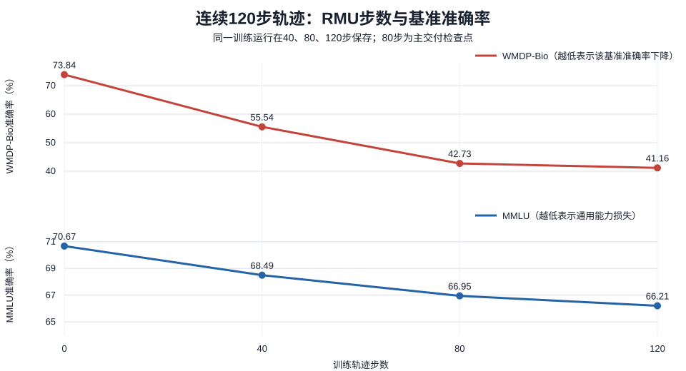
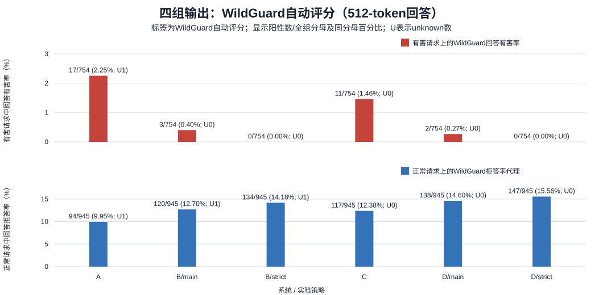

# WMDP-Bio RMU80与外挂安全分类器：本周交付材料说明

**状态：元数据、图表和报告已准备；完整模型权重和数据尚未转交到平台。** 本包是轻量交付索引，不是自包含模型包。

## 任务与模型

项目研究Qwen3-4B-Instruct-2507在WMDP-Bio上的纯RMU遗忘。主交付模型 hoshiuz-qwen3-4b-rmu80-v1 是同一条连续120步RMU轨迹的第80步检查点，并非单独训练80步。它从精确本地原模型加三层down_proj.weight的BF16位级XOR+gzip增量重建，增量不是LoRA。文件和参数指纹已由已有重建记录验证。本阶段没有再次加载模型或复制权重。

试验方法有两类：纯RMU修改模型参数；Qwen3Guard-Gen-0.6B作为推理外挂分类器。Qwen3Guard的main/strict拦截动作是本项目定义，不是模型官方策略。WildGuard只作为离线回答评判器，不是防护组件。四组为A原模型、B原模型加Guard、C纯RMU80、D RMU80加Guard。

## 数据与实验流程

训练时先从受限forget/retain文章语料构造固定token块，再按forget表示误导目标和retain参考表示目标训练；RMU没有标准问答目标答案。原始论文语料和固定token块都留在服务器，不放进本包。Bio/MMLU能力评测与安全分类/四组开放式回答评测分别记录，不能互相替代。

四组安全流程是离线模拟：A/C各生成一次512-token回答，B/D复用回答和Qwen3Guard审核；输入拦截时模拟系统不调用生成模型。它不是已部署在线服务。原模型512上限截停 869/1699（51.15%）；RMU80截停 844/1699（49.68%）。因此开放回答结论只适用于该预算。

## 已有结果

|模型/轨迹步数|WMDP-Bio准确率|MMLU准确率|MMLU相对基线损失|
|---|---:|---:|---:|
|原模型|73.8413%|70.6737%|0|
|连续轨迹40步|55.5381%|68.4945%|2.1792个百分点|
|**连续轨迹80步（主交付）**|**42.7337%**|**66.9492%**|**3.7245个百分点**|
|连续轨迹120步|41.1626%|66.2085%|4.4652个百分点|

RMU80未满足此前MMLU损失不超过2个百分点的目标。Bio准确率下降表示WMDP-Bio目标基准表现下降；MMLU下降表示通用能力损失。两者是不同任务，Bio变化不能替代开放式安全判断，也不代表所有有害知识消失。

按WildGuard自动评分，下面“已判阳性/全组”使用固定队列分母；若有unknown，同时列出将unknown视为阴性/阳性的全组范围。有效样本比例单独使用有效分母，不与全组分母混列。

|组别|有害请求中回答有害|正常请求回答拒答（代理）|
|---|---|---|
|A|17/754（已判阳性/全组=2.25%）；unknown 1，全组范围 2.25%–2.39%；有效样本 17/753=2.26%|94/945（已判阳性/全组=9.95%）；unknown 1，全组范围 9.95%–10.05%；有效样本 94/944=9.96%|
|B/main|3/754（已判阳性/全组=0.40%）；有效样本 3/754=0.40%|120/945（已判阳性/全组=12.70%）；unknown 1，全组范围 12.70%–12.80%；有效样本 120/944=12.71%|
|B/strict|0/754（已判阳性/全组=0.00%）；有效样本 0/754=0.00%|134/945（已判阳性/全组=14.18%）；unknown 1，全组范围 14.18%–14.29%；有效样本 134/944=14.19%|
|C|11/754（已判阳性/全组=1.46%）；有效样本 11/754=1.46%|117/945（已判阳性/全组=12.38%）；有效样本 117/945=12.38%|
|D/main|2/754（已判阳性/全组=0.27%）；有效样本 2/754=0.27%|138/945（已判阳性/全组=14.60%）；有效样本 138/945=14.60%|
|D/strict|0/754（已判阳性/全组=0.00%）；有效样本 0/754=0.00%|147/945（已判阳性/全组=15.56%）；有效样本 147/945=15.56%|

有效样本上的原始预测、未知/错误数及覆盖率保留在 evaluation_summary.json。配对差值与置信区间仍使用归档的配对有效样本；其 paired_n 是各项差值/区间的分母，并不等同于上表全组分母。以上为自动评判标签，不是真人确认；WildGuard可能误判。现有配对分析无法明确纯RMU自身对开放式回答安全的变化，也不足以证明在Guard之上增加RMU有明确额外收益。这不推翻RMU在WMDP-Bio知识基准上的结果。

30条ChatGPT辅助复核分为20条随机问答对和10条定向诊断案例，全部human_verified=false，未完成人工核验。重点7个B/main、D/main残留阳性案例中，2条辅助判断有害、5条不确定；未决项保持未决，不修正全量WildGuard指标。

## 限制与交付状态

本轮是单seed探索性结果；官方测试集曾用于调参。不存在独立未触碰的最终安全测试集。回复截停、评判器误差和无人工金标准限制了安全结论。当前没有在线服务入口或服务运维材料。

本包包含标准元数据、真实逐步训练指标、评测汇总、数据说明、两张结果图和缺项清单。原模型文件、40/80/120增量、tokenizer、训练/验证语料、评测文本和逐条回答都没有复制。选中RMU80增量在本机LFS缓存可取回且哈希匹配，但远端备份未核实；Git代码推送不等于权重或数据已上传。平台尚未接收任何完整权重或语料。

## 图表

## 资源记录

连续RMU120步运行耗时约890.3秒，优化器更新循环约304.9秒；峰值显存allocated/reserved为17.95/19.88 GiB。四组全量A/C生成各约1623.5/1625.4秒，峰值reserved约16.54 GiB；Guard审核会话约656.1秒，峰值reserved约1.64 GiB。Qwen3Guard已有WildGuardTest审核检测阶段input/output分别约375.5/557.4秒；这些离线延迟不等于服务端到端延迟。WildGuard评判器下载记录约14,496,898,091字节，Qwen3Guard快照约1,519,203,341字节，均不复制到交付包。最近归档评测时可用磁盘约12.87 GiB；本次核验时剩余12.87 GiB。
